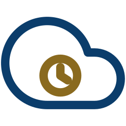

# fez backup



fez allows you to perform remote, encrypted Time Machine backups over the
internet, securely. It requires just a Linux server with SSH that can run
a docker container, and installs no local software on your mac.

Documentation can be found at <a href="https://fezbackup.com">fezbackup.com</a>.

## Quick start

```
curl -o /tmp/install_fez.sh https://fezbackup.com/install.sh
chmod +x /tmp/install_fez.sh
/tmp/install_fez.sh 1.2.3.4
```

Replace `1.2.3.4` with your server's address. If you want to administer multiple
users, provide the `--multiuser` flag to the install script.

This script will install fez on the server if needed, and configure and mount a
share called "timemachine" that can be set up as a Time Machine destination. It
is idempotent, so you can run it multiple times on different macs. Use `--share`
to configure a new share.

## Recommended Provider

If you are near the US, we recommend InterServer's storage VPS offering, which
is extremely cheap and available in three DC locations.

If you'd like to support the project, consider using [our affiliate link](https://www.interserver.net/r/925312?url=https://www.interserver.net/vps/storage.html)!

InterServer rents storage VPS servers by the slice, at $3 per TB per month.

| Storage | Price | Good for |
| ------- | ------------- | ----------------------------------- |
| 1 TB | $3 per month | A laptop with a 256 or 512 GB drive |
| 2 TB | $6 per month | A 1 TB drive, or two macs |
| 4 TB | $12 per month | Several macs, or years of history |

## Usage

```
$ ./install.sh --help
fez installer 1.0.0

Usage: install.sh [HOST] [options]

Options:
  -h, --host HOST     SSH hostname or IP of your VPS
      --server HOST   Same thing, for when you are joining someone else's
                      server and never log in to it
  -p, --port PORT     SSH port (default: 22)
  -u, --user USER     SSH user (default: root)
      --tls-port PORT The port the tunnel listens on (default: 443)
      --share NAME    Name of the share on the server (default: timemachine)
      --enroll CODE   Join a server you have an invitation code for. No SSH
                      access needed: this Mac hands over its certificate and
                      gets its share name and password back. Combine with
                      --recovery to get back into a backup after a Mac dies,
                      once the admin has issued you a new code.
      --multiuser     Server side option. Enables admin UI and enroll endpoint
                      service, so you can add people from a browser instead of
                      over SSH. The Mac that installs this is the only one that
                      can reach the admin page.
      --no-automount  Do not mount the share when finished
      --admin         Make this Mac an administrator: adds its certificate to
                      the server's admin list and switches the admin page on.
                      Implies --multiuser, and needs SSH access to the server.
      --server-only   Update the server and nothing else: no certificate, no
                      tunnel, no mount, no sudo needed here. Pass --multiuser
                      as well if the server runs the admin page.
      --no-ssh        Set up this Mac only, without touching the server.
                      Use this when someone else runs the server: it prints a
                      certificate to hand them, and they add it for you.
      --local         Set up the server side on the machine you are running
                      this on, as root. No Mac, no ssh, no tunnel.
      --uninstall     Undo everything on this Mac: the tunnels, /etc/fez, the
                      loopback alias and the logs. Leaves the server, and the
                      backups on it, completely alone.
      --recovery      Set this mac up to read an existing backup rather than
                      to make new ones. Installs the tunnel and mounts the
                      share exactly as usual, then tells you how to open the
                      backup instead of how to turn Time Machine on. Combine
                      with --enroll or --no-ssh as normal.
      --help          Show this message
```

## How it works

```
Time Machine
     |
     v
127.0.0.2:445            launchd socket, one openssl process per connection
     |
     |     (mutual TLS over the internet)
     v
your-server:443          nginx, requires your client certificate
     |
     v
timemachine:445          Samba, Docker internal network only
     |
     v
    /tm                  your backups on the server's disk
```

With `--multiuser` there are two more containers on that same port, routed via SNI:

```
your-server:443                nginx (nginx:alpine)
     |
     +-- fez.internal          your client certificate  -> Samba (mbentley/timemachine:smb)
     +-- public.fez.internal   no certificate           -> enrollment API (node:22-alpine)
     +-- admin.fez.internal    an admin certificate     -> admin page (node:22-alpine)
```

## Keeping it updated

To update all images on the server:

```
cd /etc/fez && docker compose pull && docker compose up -d
```

Re-running the installer against the same server is also safe. It keeps your
existing keys and certificates, rewrites the configuration and restarts the
containers, leaving your Time Machine setup alone:

```
/tmp/install_fez.sh 1.2.3.4
```

To see what is running now:

```
cd /etc/fez && docker compose config | grep image:
```

## License

MIT

## Trademarks

fez is not affiliated with, authorized by, or endorsed by Apple Inc. Time
Machine, Finder, macOS and mac are trademarks of Apple Inc., used here only to
describe what fez works with.
